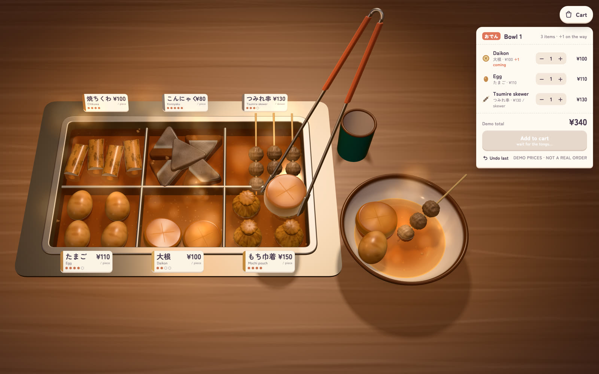
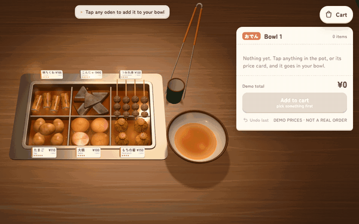
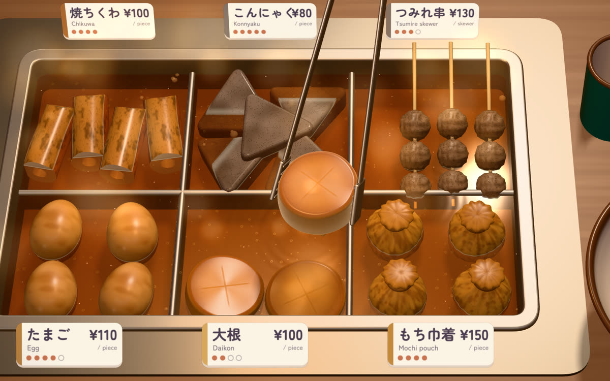
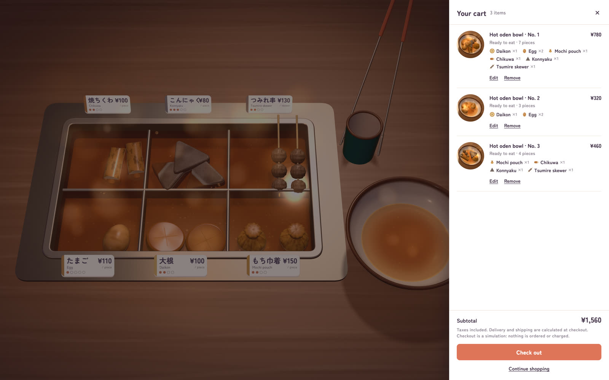
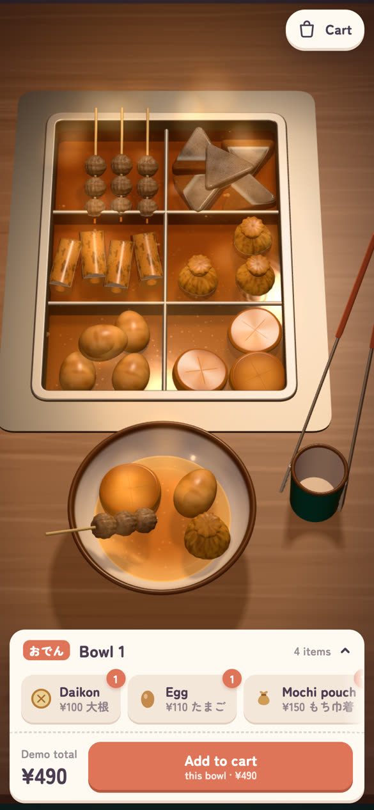
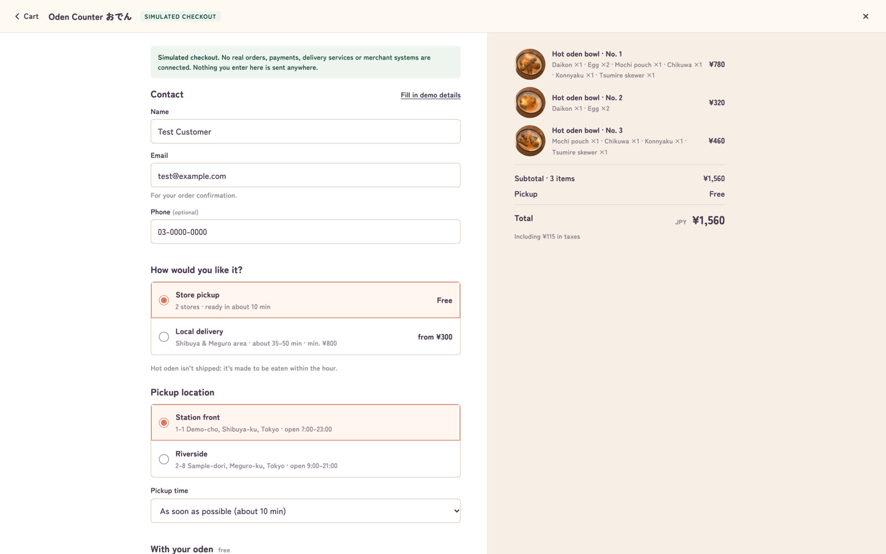

# Playable Oden

[English](README.md) | **简体中文**

**一个能直接下单的 3D 关东煮锅台。** 用夹子从咕嘟咕嘟的锅里夹出食材，配好自己的一碗，再把它变成购物车，全部在浏览器里完成。



> **[▶ 在线试玩](https://scenariofour.github.io/playable-oden/)** · 电脑和手机都能玩 · 加上 [`?merchant=chilled`](https://scenariofour.github.io/playable-oden/?merchant=chilled) 可开启快递配送
>
> **结账只是模拟。** 没有接入任何真实的订单、支付、配送服务或商家接口。
> 价格、门店和配送范围都是虚构的，你填写的内容不会发送到任何地方。

## Playable Oden 是什么？

大多数网上卖吃的店铺，都是一格一格的商品卡片。Playable Oden 把这些格子换成了柜台本身。在日本便利店，关东煮在收银台旁边分格的锅里慢慢煮着，你一块一块挑自己想要的。在这里，你在 3D 里做同样的事：点一下萝卜，夹子会把它从汤里夹起来，送到你的碗里放下。在碗里再点一下，它就回到锅里。每一次挑选都是一行订单，碗配好了就加入购物车，然后像在任何外卖网站一样结账。

项目分为两部分：

- **锅台（station）**：锅、汤、六种食材、夹子、碗、热气和补货。它是一个独立的 Three.js 模块，可以嵌入其他 3D 场景。
- **商店（shop）**：围绕锅台的一套普通点单栏、购物车和单页结账，附带自提、同城配送和快递的演示商家设置。

<p align="center"></p>

## 主要特性

- **能玩的锅台。** 六种程序化建模的食材（萝卜、鸡蛋、年糕福袋、竹轮、魔芋、鱼丸串）泡在半透明的汤里。汤面会起波纹，会挂在夹起的食材上，也会一直微微沸腾。每一格都冒着热气。
- **有分量感的夹子。** 食材沿着弧线被夹起、搬运、放下，被夹住时会轻微变形，会滴汤，落进碗里后慢慢稳住，旁边的食材也会被挤动。可以连续点多份，它们会排队。动画进行中再点一下，会让它立刻完成。
- **碗就是订单。** 点单栏是根据食材实际所在的位置算出来的，所以碗和订单永远不会对不上。可以把食材放回去，用 − / + 调整数量或撤销，一碗最多放 8 块。
- **库存和补货。** 每一格会显示还剩多少。某一格空了，店员会用托盘补上。
- **多碗下单。** **加入购物车** 会给你配好的这碗拍一张照片，把碗推向购物车，再放上一个新碗。在购物车里可以删掉某一碗，也可以把它放回柜台继续修改。
- **常规的结账流程。** 一个页面包含联系方式、取餐方式、门店和时间或配送地址、免费配料、支付方式，以及含税的订单汇总。
- **演示商家设置。** 可以是自提和同城配送的热乎关东煮，也可以是能寄快递的冷藏装，用 URL 参数切换。
- **电脑和手机两种布局。** 宽屏时碗放在锅台旁边，点单栏是一张小票。手机上锅台会重排成两列放在碗的上方，点单栏变成带菜单条的底部面板。
- **无需构建，无需后端。** 纯 ES 模块，Three.js 从固定版本的 CDN 地址加载。任何静态托管都能部署。

| 夹食材 | 配好的一碗 |
|---|---|
|  |  |
| **购物车** | **手机上** |
|  |  |

## 快速开始

需要 [Node.js](https://nodejs.org) 18 或更高版本。本项目**没有需要安装的依赖**。

```bash
git clone https://github.com/scenariofour/playable-oden.git
cd playable-oden
npm run dev
```

然后打开 <http://127.0.0.1:8080/>。需要支持 WebGL2 的浏览器，并且能联网（Three.js 和字体从 CDN 加载）。

想在同一网络下的手机上试：运行 `HOST=0.0.0.0 npm run dev`，然后打开 `http://<你电脑的 IP>:8080/`。

任何静态文件服务器也可以，例如 `python3 -m http.server 8080`。页面必须通过 HTTP 访问，因为 ES 模块无法从 `file://` 加载。

| 命令 | 作用 |
|---|---|
| `npm run dev` | 在 8080 端口托管项目根目录（可通过 `PORT` 和 `HOST` 修改）。 |
| `npm test` | 购物车、结账和商家规则的单元测试，以及结构检查（使用 Node 自带的测试运行器）。 |
| `npm run build` | 把页面用到的文件复制到 `dist/`，有任何 import 缺失就报错。 |
| `npm run preview` | 托管 `dist/`。 |
| `npm run sync-station -- <dir> [--check]` | 把锅台复制到另一个项目，或检查那边的副本是否最新（见 [docs/EMBEDDING.md](docs/EMBEDDING.md)）。 |

另有一个可选的端到端检查，会在 Chrome 里用真实点击走完整个流程。共 27 项检查，覆盖挑选、撤销、多碗、修改和删除，以及自提、配送和快递的结账。运行方法见 [`test/e2e/shop-flow.mjs`](test/e2e/shop-flow.mjs) 的文件开头。

## 3D 购物是怎么运作的

1. **挑选。** 点锅里的某块食材、它的价签，或（在手机上）菜单按钮。这块食材会立刻被预留，夹子去把它取过来。落进碗里之前，点单栏会显示 `+1 coming`。
2. **改主意。** 点碗里的食材把它放回去，或者用 − / + 调整，或点 **Undo**。用键盘的话，`1`–`6` 添加食材，`Z` 或 `Backspace` 撤销。
3. **加入购物车。** 这碗的内容会被固定成一个购物车商品（明细、数量、价格、合计），并附上一张从 3D 视图里拍的碗的照片。然后放上一个新碗。
4. **购物车。** 查看各碗，删掉某一碗，或者点 **Edit** 把某一碗放回柜台修改，它会保留原来的编号。
5. **结账（模拟）。** 选择自提、同城配送或快递（视商家设置而定），填写信息或点 **Fill in demo details** 自动填写，然后提交模拟订单。结账全程标注为模拟，确认页也会明确说明没有发送订单、也没有扣款。



## 部署

这是一个静态网站。把仓库根目录（或 `npm run build` 的输出）部署到任何静态托管即可。

- **GitHub Pages**（[在线试玩](https://scenariofour.github.io/playable-oden/) 就是这样托管的）：Settings → Pages → Deploy from a branch → `main` / root。不需要构建，因为 `index.html` 就在根目录，所有路径都是相对路径，所以在 `/playable-oden/` 这样的项目子路径下也能正常运行。空的 `.nojekyll` 文件用来跳过 Jekyll 处理。
- **Netlify、Vercel、Cloudflare Pages 等**：不选框架预设，构建命令 `npm run build`，输出目录 `dist`。也可以跳过构建，直接部署根目录。

页面会从 jsDelivr 加载 Three.js r169，从 Google Fonts 加载 Zen Maru Gothic 字体。如果不想发出这些请求，可以把文件下载下来自己托管，再把 `index.html` 里的 import map 和字体 `<link>` 指向你的副本（见 [THIRD_PARTY_NOTICES.md](THIRD_PARTY_NOTICES.md)）。

## 演示商家配置

商家设置是 [`src/shop/merchant.js`](src/shop/merchant.js) 里的纯数据，用 `?merchant=` 选择。所有数值都是虚构的，只是为了让结账看起来真实。

| | `?merchant=counter`（默认） | `?merchant=chilled` |
|---|---|---|
| 卖什么 | 现做的热关东煮，即买即吃 | 同样的碗，做成冷藏装回家加热（可保存 3 天） |
| 到店自提 | 2 家演示门店，约 10 分钟可取，15 分钟一个时段 | 同样的门店，约 30 分钟，30 分钟一个时段 |
| 同城配送 | 10:00–22:00，约 35–50 分钟，30 分钟一个时段，起送 ¥800，满 ¥2,000 免配送费 | 10:00–20:00，2 小时一个时段，起送 ¥1,500，满 ¥4,000 免配送费 |
| 配送范围 | 邮编以 150、151（¥300）和 153（¥400）开头 | 同样范围，¥400–¥500 |
| 快递 | 不提供（热食不寄快递） | 冷藏普通 ¥980（2 天）或冷藏加急 ¥1,480（1 天），15:00 截单，5 个可选到货日，不寄冲绳 |
| 支付 | 银行卡（没有卡号输入框：真实店铺会用支付服务商的表单）或到店支付（仅限自提） | 同左 |
| 免费配料 | 黄芥末、多加汤、筷子 | 无 |

所有价格均含税。订单汇总里的税额包含在总价中，按日本税率计算（外带食品 8%，配送费和快递费 10%）。菜单价格为每块 ¥80–¥150，写在 [`src/station/foods.js`](src/station/foods.js) 的 `FOODS` 里。

## URL 参数

| 参数 | 效果 |
|---|---|
| `?merchant=counter` / `chilled` | 演示商家设置（见上文）。 |
| `?layout=side` / `front` | 强制使用宽屏布局（碗在锅台旁边）或手机布局（碗在前面）。 |
| `?frame=9x16` | 以手机布局渲染一个居中的 9:16 竖屏画面，方便录制竖屏视频。 |
| `?ui=0` | 隐藏点单栏、购物车按钮和提示，只留下场景。随时按 `H` 切换。 |
| `?debug` | 显示帧率计数器。 |

录制 16:9 视频时，把浏览器视口调成 16:9（例如 1920 × 1080）。如需逐帧精确录制，`window.__oden.advance(seconds)` 会确定性地推进模拟并渲染一帧，录制脚本可以按任意帧率截下每一步。

## 目前可以怎么定制

以下内容可以通过修改代码来改（没有配置界面或导入工具）：

- **商家设置**：门店、营业时间、配送范围、费用、快递价格、支付方式和配料，在 `src/shop/merchant.js`。
- 六种食材的**名称、价格、单位和初始库存**：`src/station/foods.js` 里的 `FOODS`。
- **商店界面的文案和样式**：`src/shop/shop.js`、`src/shop/ui.js` 和 `index.html` 里的 `<style>`。
- **布局和镜头**：`src/shop/main.js` 里的 `LAYOUTS` 和 `frameCamera()`。
- **把锅台嵌入别的地方**：见 [docs/EMBEDDING.md](docs/EMBEDDING.md) 和 [`examples/embed.html`](examples/embed.html) 里的最小宿主页面。

目前增加一种新食材需要实打实的工作量：需要新的几何体和着色器颜色、在格子里的摆放方式，以及小票图标。[docs/ARCHITECTURE.md](docs/ARCHITECTURE.md) 说明了哪些部分仍然默认只有这六种演示食材。

## 项目结构

```
index.html            页面：样式、import map（three.js r169）、点单栏结构
src/
  station/            3D 锅台：从不引用商店代码
    station.js          createStation()：挑选、夹子、搬运、碗、补货、撤销
    foods.js            六种食材：几何体、着色器和演示菜单（FOODS）
    broth.js, fx.js     汤面、热气、滴落、气泡
    props.js, set.js    锅、碗、夹子、托盘、柜台、绘制的反射
    tags.js, motion.js  场景里的价签、弹簧和补间动画
  shop/               围绕锅台的独立商店
    main.js             宿主：渲染器、灯光、镜头、输入、购物车状态
    ui.js               点单栏、价格弹出、提示
    shop.js             购物车按钮、购物车抽屉、结账页
    checkout.js         购物车和结账规则、placeDemoOrder()（不依赖 DOM，有单元测试）
    merchant.js         演示商家设置
examples/embed.html   单独运行锅台的最小宿主页面
scripts/              开发服务器、构建、锅台同步（只用 Node 内置模块）
test/                 单元测试和结构测试；test/e2e/ 是可选的浏览器检查
docs/                 架构说明、嵌入指南、README 图片
```

代码分为五层：锅台与交互、商品目录、订单与购物车状态、宿主与呈现、商家设置与结账边界。[docs/ARCHITECTURE.md](docs/ARCHITECTURE.md) 介绍了每一层、它目前在哪里，以及哪些层还混在一起。

## 对接真实商家

**已有的部分：** 一个购物车模型，每一碗都是一组固定的明细（商品 id、名称、单价、数量、金额）；购物车校验，会拒绝未知商品和过期价格；履约规则（按商品温度决定可选方式、营业时间和时段、按邮编划分的配送范围、起送价和免配送费门槛、快递价格、截单时间和不配送地区）；含税报价；以及一个函数 `placeDemoOrder()`，订单会在这里交出去。

**没有的部分：** 真实的商品目录或库存对接、后端、订单提交、支付处理、地址校验、配送计价、用户账号、订单历史、邮件确认。任何东西都不会被存储或发送。购物车只存在内存里，刷新页面就没了。

真正的对接会用商家自己的商品目录和设置替换 `FOODS` 和 `merchant.js`，并把 `placeDemoOrder()` 换成一次交接：根据各碗的明细和所选的履约方式，在商家自己的系统里创建购物车或结账会话，再交给他们安全的托管结账页完成支付。

## 已知限制

- **仅为演示。** 不会发送订单，也不会收款。价格、门店和区域都是虚构的。
- **只有六种食材。** 菜单、格子布局、小票图标和键盘快捷键都是围绕这六种演示食材做的。换成别的商品需要改代码（见 [docs/ARCHITECTURE.md](docs/ARCHITECTURE.md)）。
- **结账针对日本。** 日元、日本邮编、日本税率。场景里的价签以日文名为主，下方附英文名。点单栏、购物车和结账页是英文的。
- **不保存数据。** 刷新页面后碗和购物车都会清空。
- **需要 WebGL2 和较新的 GPU。** 在近几年的手机上可以运行，但较老的设备可能掉帧。没有 2D 降级版本。
- **运行时需要联网。** 除非自己托管，Three.js 和字体都从 CDN 加载。
- **无障碍支持不完整。** 点单栏、购物车和结账支持键盘和读屏软件，每次变化都会实时播报。3D 锅台本身以鼠标和触控为主，键盘用户可以用菜单按钮或 `1`–`6` 键添加食材。

## 参与贡献

欢迎提 issue 和 pull request，详见 [CONTRIBUTING.md](CONTRIBUTING.md)（英文）。简单来说：不要在 `src/station/` 里放商店代码，运行 `npm test`（改了界面的话再跑一下可选的浏览器检查），并保证手机上依然流畅。

## 许可与致谢

代码以 [MIT 许可证](LICENSE) 发布。

项目没有打包任何第三方素材，所有模型、贴图和图标都由代码生成。运行时会加载 [three.js](https://threejs.org)（MIT）和 Yoshimichi Ohira 设计的 [Zen Maru Gothic](https://fonts.google.com/specimen/Zen+Maru+Gothic) 字体（SIL Open Font License 1.1）。详情和声明见 [THIRD_PARTY_NOTICES.md](THIRD_PARTY_NOTICES.md)。

灵感来自日本便利店收银台旁的关东煮锅。

作者：[Iris](https://irisli.dev/)。更多作品见同样做成 3D 便利店的作品集 [RIRRI'S](https://world.irisli.dev/)。
